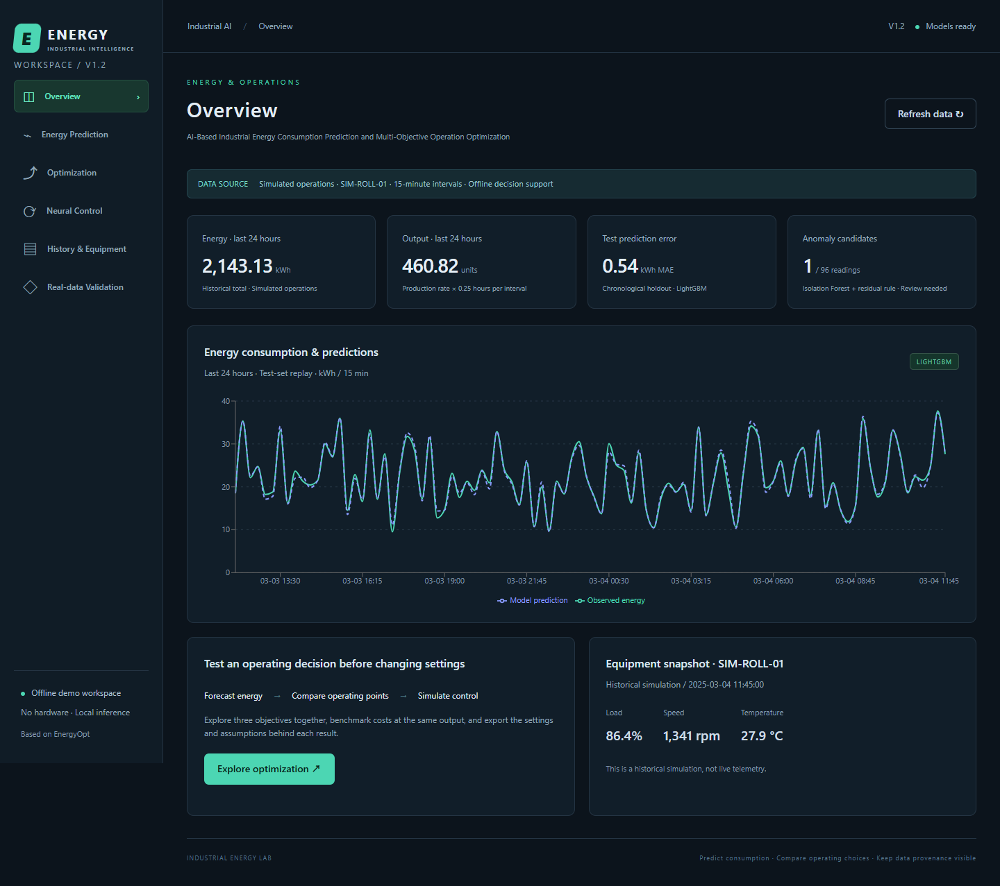

# Industrial Energy Platform · V1.2

**AI-Based Industrial Energy Consumption Prediction and Multi-Objective Operation Optimization Platform**

A local derivative of [Kaviyathamizhan/EnergyOpt](https://github.com/Kaviyathamizhan/EnergyOpt), built with React, FastAPI, LightGBM, Isolation Forest, pymoo NSGA-II, a deep ANN dynamics model and feedback MPC. All active UI content, messages, charts, documentation and API explanations are in English. No sensors, PLCs, cloud services or other hardware are required.



## Quick start

Verified on Windows with Python 3.13.9 and Node.js 24.14.0. Use the same version families for the closest reproduction. Initial dependency installation needs internet access; prepared data, models and the built application run locally offline.

### This prepared workspace

From the project directory:

```powershell
.\start.ps1
```

Open http://127.0.0.1:8000 for the dashboard and http://127.0.0.1:8000/docs for interactive API documentation. If the service is already running, just refresh the browser. Stop the terminal service with Ctrl+C. Use `./start.ps1 -Port 8001` if port 8000 is occupied.

If PowerShell execution policy blocks the script, run the server directly:

```powershell
.\.venv\Scripts\python.exe -m uvicorn api.industrial_app:app --host 127.0.0.1 --port 8000
```

### A new machine / extracted source package

Install Python and Node.js, then run from the project root:

```powershell
.\setup.ps1
.\start.ps1
```

The package includes the UCI CSV, synthetic data, trained models and frontend build. The setup script installs dependencies, retrains the local models and rebuilds the frontend. Use `./setup.ps1 -DownloadSteel` to download a fresh UCI copy.

Manual equivalent:

```powershell
python -m venv .venv
.\.venv\Scripts\python.exe -m pip install -r requirements-industrial.txt
.\.venv\Scripts\python.exe -m scripts.prepare_industrial
cd frontend
npm ci
npm run build
cd ..
.\.venv\Scripts\python.exe -m uvicorn api.industrial_app:app --host 127.0.0.1 --port 8000
```

On Linux/macOS use `python3 -m venv .venv` and `.venv/bin/python`; these platforms have not been tested in this delivery. `requirements-lock.txt` records the full verified Python environment, including optional browser-test dependencies. Standard installation uses `requirements-industrial.txt`.

**Use `api.industrial_app:app` and `requirements-industrial.txt`.** The original `api.main:app` and `requirements.txt` belong to the retained upstream household application.

### Development mode

Run the API on port 8000 in one terminal. In another, enter `frontend` and run `npm run dev`. Open http://127.0.0.1:5173. Vite forwards `/api` to the local API. For normal demonstrations, the production build is served by FastAPI and only one process is needed.

Optional `VITE_API_URL` overrides the frontend API prefix. The default is `/api`; copy the example to `frontend/.env.local` when using an override. Cross-origin deployment also requires adjusting backend CORS. The supplied configuration is for local use.

## Deep ANN control added in V1.2

Open **Neural Control** or navigate directly to `/#control`. The application now implements a trained three-hidden-layer ANN (11 → 96 → 64 → 32 → 6), a dynamic simulated plant and receding-horizon MPC. The controller predicts future states, executes the first bounded action, reads the actual new simulated state and repeats.

Use **Closed-loop experiment** for setpoint/disturbance tracking with a fixed-command comparison, plots, measurement playback and JSON export. Use **Interactive control** to change the target, apply a disturbance and execute one feedback step at a time. All content remains in English.

The ANN is trained on 7,200 transitions and evaluated on 1,800 transitions from independent held-out simulated trajectories. Energy MAE is 0.09085 kWh; five-step recursive energy MAE is 0.10021 kWh. LightGBM and persistence comparisons use the same dynamic test set. Default closed-loop production tracking MAE is 0.44627 units/h versus 7.15581 for fixed commands, with zero observed energy/temperature violations. These are simulation results, not real plant validation or verified savings.

New source files: `api/industrial/plant.py`, `neural.py`, `control.py`, `frontend/src/pages/NeuralControl.jsx`, `frontend/src/neural-control.css`, `scripts/train_neural.py`, `scripts/browser_neural.py`, and `tests_industrial/test_neural_control.py`. New endpoints: `GET /api/control/model`, `POST /api/control/run`, `POST /api/control/step`. The standard preparation script now trains the ANN; no new runtime dependencies are required.

See [NEURAL-CONTROL.md](docs/NEURAL-CONTROL.md) for training, simulator equations, control design, actual results and API examples. Retrain with `python -m scripts.train_neural`, then restart the API. LightGBM prediction and NSGA-II optimization continue as separate tools.

## Previous V1.1 improvements

- English navigation, forms, legends, table headings, empty states, errors, document metadata and documentation.
- Prediction inputs/results and optimization inputs/results remain available when switching pages, including when an optimization finishes in the background. History filters and pagination also remain intact. A full reload begins a new session.
- Direct page links such as `/#predict`, `/#optimize`, `/#history` and `/#steel`, with browser history support.
- Balanced, energy-conscious and high-output scenario presets; each clearly sets constraints and preference weights.
- Candidate sorting by recommendation score, energy, cost or production rate.
- English mobile layouts and broader automated browser coverage.

## Demonstrating operating decisions

Open **Optimization**, run **Balanced production**, and rotate the **3D Pareto Front**. The axes show energy (kWh per 15 minutes), total cost (CU per 15 minutes), and production rate (units/hour). Select a point to inspect its operating settings, cost breakdown, and comparison with the reference. The gold star identifies the preference-ranked recommendation.

Expand **Reference operating settings** to describe the settings in use. The defaults are 70% load, 1,200 rpm, and power factor 0.90. The **Same-output benchmark** fixes production at the reference rate, derives the required load at each sampled speed, and compares feasible speed and power-factor combinations under the same tariff, temperature, and energy limit. It shows the lowest modeled cost among those combinations and includes the reference in the search. This is a separate comparison from the NSGA-II front. If the reference fails the scenario constraints, the page explains how to make the comparison available.

The platform supports three distinct demonstrations: forecasting on measured steel data, comparing operating decisions in a static simulation, and testing feedback control in a dynamic simulation. The run report includes the scenario, seed, model identifier, front, reference, same-output benchmark, recommendation, and selected point. The CSV contains every point on the front. Cost is illustrative; optimization and control results are simulation estimates.

## Pages

| Page | Capabilities |
|---|---|
| Overview | Last 24 historical hours of energy/output, anomaly count, test MAE, energy curves and equipment snapshot |
| Energy Prediction | Operating inputs, derived production rate, energy prediction, calibrated interval and optional observed-energy anomaly check |
| Optimization | Constraints, presets, preference weights, NSGA-II search, interactive 3D Pareto front, recommendation, editable reference, same-output benchmark, and exports |
| Neural Control | Deep ANN model, simulated plant, feedback MPC, setpoint/disturbance experiments, interactive stepping and exports |
| History & Equipment | Simulated equipment, paginated readings, anomaly filtering, current-page export and data-split labels |
| Real-data Validation | Separate measured steel and SCADA compressor benchmarks, chronological accuracy, selectable forecast windows, baseline comparisons and CSV export |

## Data provenance and interpretation

The measured benchmarks use separate steel plant and compressor meter data. Neither source includes the command, production and process response records required by the simulation's optimizer or neural controller. See [Measured industrial energy benchmarks](docs/REAL-DATA-BENCHMARKS.md) for sources, reproduction and candidate data for later work. The platform keeps these workflows distinct:

1. **Measured steel forecasting:** original UCI observations, a 15-minute one-step forecast, historical energy and previous power factor, a chronological 80/20 split, and a persistence baseline. Previous observed test readings are available at each subsequent prediction step. This is not a 48-hour open-loop forecast.
2. **Synthetic operating optimization:** 6,000 independently generated operating points, seed 42. Operating variables are sampled first and energy is generated from a documented demonstration equation. No machine variables are reverse-engineered from UCI energy targets. Train/calibration/test shares are 70/15/15.

`production_rate` is derived from load, speed and temperature and used as a model feature. It is not a freely adjustable input that could contradict machine capacity. `energy_kwh` is the target or an optional observation for anomaly detection, never a same-interval prediction feature. Production uses abstract units, not tonnes of steel.

The synthetic model's high R² demonstrates learning the generator, not validation on a real production line. Anomaly candidates are unsupervised review flags, not diagnosed faults. Optimization is approximate and model-based, with no verified industrial savings claim. Reference comparisons show output changes alongside energy and cost; a lower energy value does not automatically establish improved efficiency.

## Engineering layout

The full source/build inventory is in [docs/FILE-TREE.txt](docs/FILE-TREE.txt).

```text
industrial-energy/
├── README-V1.md                  Current setup and usage guide
├── README.md                     Upstream README with current-version navigation
├── UPSTREAM.md                   Original commit, reuse and licensing notes
├── requirements-industrial.txt   Application dependencies
├── requirements-lock.txt         Verified Python environment
├── setup.ps1 / start.ps1         Setup and local startup
├── pytest.ini                    Selects the industrial test suite
├── api/
│   ├── industrial_app.py         App lifecycle, CORS and frontend hosting
│   └── industrial/
│       ├── data.py               Generator, capacity equation and feature contract
│       ├── models.py             Both training pipelines and artifact persistence
│       ├── schemas.py            Input validation and resource limits
│       ├── optimizer.py          NSGA-II, recommendation and reference comparison
│       ├── service.py            Prediction, anomaly detection and historical state
│       └── routes.py             REST endpoints
├── frontend/
│   ├── package.json / package-lock.json
│   ├── vite.config.js / index.html
│   ├── src/
│   │   ├── main.jsx / App.jsx
│   │   ├── pages/IndustrialDashboard.jsx
│   │   ├── pages/Optimization.jsx
│   │   ├── components/IndustrialChart.jsx
│   │   ├── components/WorkspaceState.jsx
│   │   ├── services/industrial.js
│   │   └── index.css / industrial.css
│   └── dist/                     Built UI hosted by FastAPI
├── scripts/
│   ├── prepare_industrial.py      Generation, optional UCI download and training
│   ├── browser_smoke.py           Compatibility entry for browser acceptance
│   ├── browser_acceptance.py      Desktop/mobile end-to-end checks
│   └── package_project.py         Validated archive creation
├── data/industrial/
│   ├── README.md                 Attribution and data license
│   ├── operations_demo.csv
│   ├── Steel_industry_data.csv
│   └── steel_test_preview.csv
├── artifacts/industrial/
│   ├── operations.joblib / steel.joblib
│   └── operations_metrics.json / steel_metrics.json
├── tests_industrial/test_platform.py
└── docs/
    ├── MODEL-DESIGN.md
    ├── VALIDATION.md
    ├── FILE-TREE.txt
    └── screenshots/
```

The original backend, artifacts, scripts, tests and React components remain for upstream comparison. The active industrial application does not mount the household pipeline or single-objective LP endpoints.

## API

| Method | Path | Purpose |
|---|---|---|
| GET | `/api/health` | Version, language and health |
| GET | `/api/summary` | Historical KPIs, equipment snapshot and synthetic metrics |
| GET | `/api/history?limit=48&offset=0&anomalies_only=false` | Newest-first pagination; rows inside a response page are chronological |
| GET | `/api/steel` | Original measured steel metrics and final 192 test predictions |
| GET | `/api/real-benchmarks` | Measured steel and compressor comparisons and time-aligned test windows |
| POST | `/api/predict` | Energy prediction and optional anomaly check |
| POST | `/api/optimize` | Three-objective search, editable reference, and same-output benchmark |

Prediction request:

```json
{"machine_load":0.7,"machine_speed":1200,"temperature":32,"power_factor":0.9,"energy_kwh":25}
```

Omit `energy_kwh` to skip the anomaly check (`anomaly=null`). Reasons appear in `anomaly_reasons`. Passing `production_rate` returns 422 because capacity is computed consistently on the server.

Optimization request:

```json
{"temperature":32,"tariff":0.8,"min_production_rate":12,"max_energy_kwh":50,"weights":[1,1,1],"population":80,"generations":70,"seed":42,"reference":{"machine_load":0.7,"machine_speed":1200,"power_factor":0.9}}
```

Successful responses contain `pareto`, `recommended`, `reference`, `same_output_benchmark`, `request`, `elapsed_seconds`, `created_at`, `model_version` and algorithm metadata. The benchmark returns a candidate only when the reference meets the scenario's production and energy limits. Omitting `reference` uses the default settings. No feasible search result returns HTTP 200 with `status=no_feasible_solution`, an English explanation and an empty front. This is not a proof that no mathematical solution exists. Invalid bounds, weights, non-finite values and excessive search budgets return 422.

The model identifier describes the current generator/training recipe, not an immutable artifact hash. Exact reproduction also requires retaining the model files and dependency versions. Concurrent production deployment and multi-user isolation are outside V1.1 scope.

## Model results and validation

| Workflow | MAE kWh | RMSE kWh | R² | Baseline MAE kWh |
|---|---:|---:|---:|---:|
| Synthetic operations, 900 test rows | 0.5449 | 0.6889 | 0.9908 | 5.9496, training mean |
| Measured UCI, 6,989 test rows | 4.2771 | 8.6981 | 0.9232 | 5.4822, persistence |

The synthetic 90% nominal prediction interval achieved 89.44% test coverage. It is a prediction interval, not a confidence interval for a mean. Optimization constraints currently use point predictions rather than uncertainty bounds.

The 3D Pareto update passes 29 backend tests, the production frontend build, and browser acceptance checks with no page script errors. See [VALIDATION.md](docs/VALIDATION.md).

```powershell
.\.venv\Scripts\python.exe -m pytest -q
.\.venv\Scripts\python.exe -m scripts.prepare_industrial
```

Restart the API after retraining so its in-memory operating model refreshes. Missing synthetic artifacts are generated on first startup. An absent UCI benchmark produces an explicit preparation message, not synthetic replacement data.

Optional browser checks require Edge and a running API:

```powershell
.\.venv\Scripts\python.exe -m pip install playwright==1.63.0
.\.venv\Scripts\python.exe scripts/browser_smoke.py
```

Generate the handoff archive:

```powershell
.\.venv\Scripts\python.exe scripts/package_project.py
```

The current archive is industrial-energy-v1.2-neural-control.zip. It excludes installed dependencies, Git internals and runtime caches. It includes the current build, source, models, data and English screenshots.

## Roadmap and limitations

CSV and model files are persistent; interactive inputs/results live in the browser's current React session and reset on full reload. Refresh data updates the overview dataset without discarding in-session calculations. There is no database, authentication, hardware control, online training or job queue.

If PostgreSQL is required, introduce machines, readings, model_versions, optimization_runs and pareto_solutions tables with migrations. If Django REST Framework is required, retain the algorithm modules and replace the API/persistence layer. A real operating optimizer first needs synchronized machine, production and energy measurements, validated constraints and calibrated cost coefficients. See [MODEL-DESIGN.md](docs/MODEL-DESIGN.md).

## Sources

- [EnergyOpt](https://github.com/Kaviyathamizhan/EnergyOpt): pinned upstream commit and license status in [UPSTREAM.md](UPSTREAM.md).
- V E, S., Shin, C., & Cho, Y. (2021). [Steel Industry Energy Consumption](https://doi.org/10.24432/C52G8C), UCI Machine Learning Repository, CC BY 4.0.
- [pymoo NSGA-II documentation](https://pymoo.org/algorithms/moo/nsga2.html).
