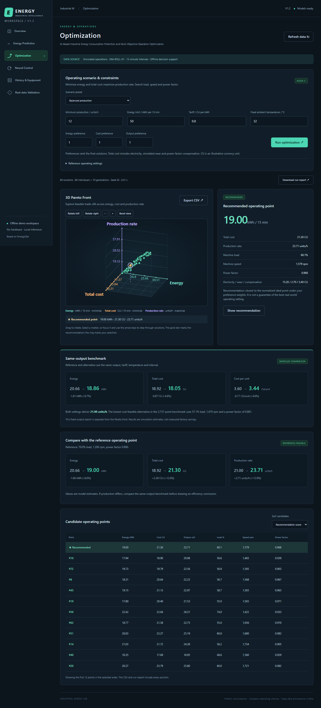

# AI-Based Industrial Energy Consumption Prediction and Multi-Objective Operation Optimization Platform

A local decision-support prototype for exploring how industrial operating choices affect energy, cost, and production. It combines a React dashboard with a FastAPI service and runs without connected equipment.

- **Energy prediction and review:** LightGBM estimates interval energy use. Isolation Forest and forecast errors identify unusual records for review.
- **Multi-objective optimization:** NSGA-II searches for operating points that minimize energy and cost while maximizing throughput. A rotatable 3D Pareto chart shows the trade-offs, and a fixed-output benchmark compares alternatives with an editable reference.
- **Neural control:** A deep artificial neural network predicts plant dynamics for a feedback controller tested in simulation.
- **Measured-data validation:** Separate 15-minute benchmarks use steel plant and air compressor meter readings. The dashboard displays forecasting errors, baseline comparisons, and exportable traces.

## Run locally

Install Python 3.13 and Node.js 24. From the project directory in PowerShell:

~~~powershell
.\setup.ps1
.\start.ps1
~~~

Open [the dashboard](http://127.0.0.1:8000/) or [the API documentation](http://127.0.0.1:8000/docs). Setup installs dependencies and builds the frontend. For development and testing, see the [project guide](README-V1.md).

## Data and scope

The measured steel and compressor data validate forecasting on their own test periods. Operating optimization, cost estimates, anomaly demonstrations, and feedback control use simulation. See the [measured-data guide](docs/REAL-DATA-BENCHMARKS.md) for sources, attribution, and training steps.

This project builds on [Kaviyathamizhan/EnergyOpt](https://github.com/Kaviyathamizhan/EnergyOpt). See [upstream provenance](UPSTREAM.md) for the source revision and licensing details.
